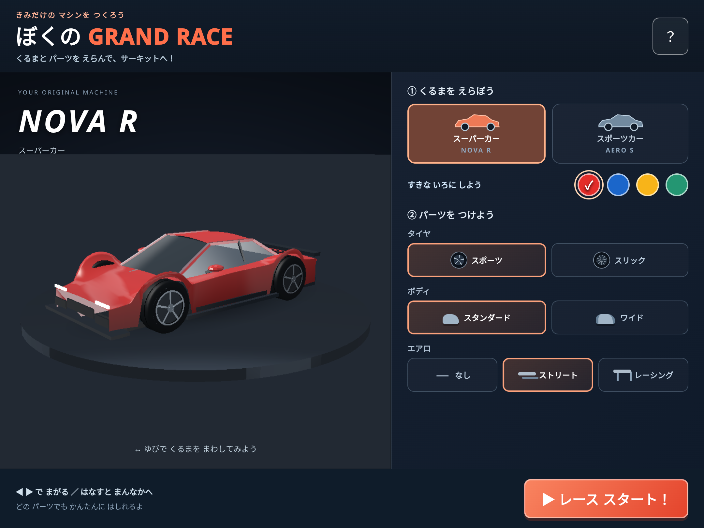

# Ver.5：左右操作・グラフィック・ガレージの調査と検証

## 左右が逆になる原因と修正

対象は公開版Ver.4、mainコミット `6191067` です。追従カメラはワールド+Z方向を見ています。標準的な右手系の `lookAt` では、カメラの右軸 `cross(forward, up)` がワールド-Xになります。旧コードは右入力で正になったレーンの移動量をそのままワールド+Xに加算していたため、右入力が画面左へ投影されていました。

実際の投影行列を使い、スタート地点で車を3m右へ移動させた場合を比較しました。

| 座標変換                  | 画面の正規化X座標 | 画面上の方向 |
| ------------------------- | ----------------: | ------------ |
| 旧 `center(z) + offset`   |           -0.3523 | 左           |
| 修正 `center(z) - offset` |           +0.3523 | 右           |

入力の右方向を正のレーン移動量として保持し、`laneWorldX` でワールド座標へ変換します。車体・相手車・カメラの追従位置と、操舵時の車体／前輪の向きを同じ規則に揃えました。

前回のテストは内部の移動量が正になることまでを検証していました。今回は実際のレンダラーで使う投影行列と描画位置を通して、右入力で車がコース中央より画面右、左入力で画面左になることを検証します。周回境界や曲がった区間も単体テストに含めています。

## ガレージとパーツ

レース開始前と完走後に3Dガレージを表示します。車をドラッグ／左右キーで回転し、次を選べます。

| 対象   | 選択肢                                                                                 |
| ------ | -------------------------------------------------------------------------------------- |
| 車種   | NOVA R（スーパー系）、AERO S（スポーツ系）                                             |
| タイヤ | スポーツ（溝と5本スポーク）、スリック（溝なし・10本スポーク）                          |
| ボディ | スタンダード、ワイド（車幅・フェンダー・車輪の配置が変化）                             |
| エアロ | なし、ストリート、レーシング（スプリッター・サイドスカート・ディフューザー・ウイング） |
| 塗装   | 赤・青・黄・緑                                                                         |

選択内容は車種ごとにページを開いている間保持し、レース開始と再レースに引き継ぎます。アカウントや端末への自動保存はありません。全24通りの車種・パーツ構成で走行補助と性能は同一です。塗装も含めると96通りを選べますが、全96通りの実機評価を行ったという意味ではありません。

## グラフィックと負荷

車体の曲面を連続した頂点法線で生成し、ルーフ・ガラス・タイヤ・ホイール・エアロを分離しました。車種・ボディ形状ごとのメッシュと、タイヤ・エアロを共有して、組み合わせごとの車体全体を作り直すことを避けています。

塗装、ガラス、金属、ゴム、カーボンには別の反射・光沢を設定し、環境色、フレネル反射、スタジオの照明帯、線形色での照明計算、頂点アルファで薄くなる接地影を追加しています。外部画像や実在車両のモデル、ロゴは使っていません。環境反射と接地影は軽量な近似で、リアルタイムのレイトレーシングや家庭用ゲーム機相当の写実表現ではありません。

自車とガレージは詳細モデル、相手車は頂点数を抑えたモデルを使います。同じスタート地点で描画する頂点数を、詳細モデルのみの場合の173,094から124,518へ削減しました。これは頂点数の比較であり、iPad実機のfpsや高速化率の測定ではありません。

背景・路面・芝・ライトは車体用の反射計算を省き、頂点色はメッシュ生成時に線形化しています。フラグメント高精度は対応時に使用し、非対応時の `mediump` フォールバックを用意しました。共有uniformの精度不一致は再導入していません。カメラ相対ベクトルは正規化前にスケールし、低精度演算の中間値のオーバーフローを避けています。

描画ピクセル数は初期140万以下、最低48万。縦横両方向とGPU上限に合わせます。画質調整は画面に表示されている間の時間で判断し、重い環境で調整が遅れにくくしました。カウントダウンは低フレームレートでも可視経過時間に追従し、走行の物理計算は小さな刻みに分けます。バックグラウンドからの復帰時は時計をリセットして停止位置を保持します。

## 自動テスト

単体テスト15件はローカルで成功しています。ブラウザテストの最終定義は合計42ケース（Chromium 21、WebKit 21）で、Linux版WebKitのオフラインナビゲーション1件を明示的に除外し、41ケースを検証対象にしています。

[今回のブランチの自動テスト実行結果](https://github.com/test553378/my-drive/actions?query=branch%3Afix%2Fsteering-and-custom-garage)を参照してください。CIの `Static game checks` に最終的な成否を記録し、`browser-test-report` にブラウザ検証レポートと画面を保存します。対応PRにも確定結果を記載します。

| 検証       | 内容                                                                                                                                                                                             |
| ---------- | ------------------------------------------------------------------------------------------------------------------------------------------------------------------------------------------------ |
| 単体15件   | 実カメラ行列を通した左右方向（複数区間・周回境界）、旧座標での逆転再現、設定の独立したコピー、不正パーツの既定値、24構成の同一操作性、完走・接触・ターボ・中央復帰・時間刻み                     |
| 描画・操作 | 実シェーダーとフレームバッファ、元のuniform不整合の回帰、強制mediumpフォールバック、車体とコース中央の投影位置による左右判定、塗装・操作キャンセル・一時停止・ターボ                             |
| ガレージ   | タイヤ・ボディ・エアロ変更時の実フレームバッファの違い、車種ごとの設定保持、選択構成での出走、ドラッグとキーによる回転、24構成の描画、メッシュキャッシュとバッファ量の上限、iPad相当の縦横画面   |
| 安定性     | 診断とJSON保存、コンテキスト拒否、コンパイル／リンク失敗の注入、選択パーツを付けた状態でのGPUコンテキスト喪失・再構築、非表示／復帰、全実行ファイル10個のキャッシュ、2周の描画・ゴール・再レース |

ソフトウェア描画での初期全体実行では、描画待ちによりカウントダウンのテストがタイムアウトしました。その後、背景シェーダーの軽量化、頂点色の事前変換、相手車の軽量モデル、可視時間に基づく画質調整とカウントダウンを実装し、左右・車種／色・パーツによる実描画の主要6ケースは両ブラウザで成功しています。

Linux版Playwright WebKitのオフラインナビゲーションは、ゲームを含まない最小キャッシュページでも内部エラーになる既知の検証制約です。今回も理由を記した1ケースだけを除外しています。Chromiumの真のオフライン起動と、両ブラウザの全ファイルキャッシュは別に検証します。iPad Safariのオフライン起動の成功を示すものではありません。

## iPad第9世代で必要な確認（実機未検証）

対象はユーザー指定のiPad第9世代（A13）です。自動テストは1080×810／810×1080のCSS画面寸法とタッチ設定を使いますが、iPadOS、Safari／Metal、実際のGPU性能、発熱やメモリ制限は再現しません。

- 診断のバージョンが `5.0.0` であること。旧版が出る場合はオンラインで更新を取得し、ページ／ホーム画面アプリを閉じて開き直す。
- 実際のタッチで、右が画面右、左が画面左へ移動すること。左右＋ターボ、指をスライドして離す、2本指、端での押し続け、中央復帰。
- 2車種・タイヤ・ボディ・エアロ・色の選択、車のドラッグ回転、選択状態での出走と再レース。画面の縦横、Safariツールバー、セーフエリア、選択欄のタッチスクロール。
- 曲面・ガラス・金属・タイヤ・影の描画欠け、遠くの車の見え方、実際のフレームレート。iPadでの60fpsは保証していない。
- 10〜15分の連続走行、複数レース、発熱・電池・低電力モード、ほかのタブやアプリを使用したときの安定性。
- 画面ロック、アプリ／タブ切替、GPUコンテキスト喪失、音声のオン・オフと割り込み、復帰時の停止位置と入力解除。
- ホーム画面起動、旧Ver.4からのService Worker更新、Safari実機でのオフライン起動。Safariのデータ退避後にはオンライン読み込みが必要。
- 4〜5歳の子どもが選択肢を理解できるか、ボタンの大きさや2周の長さが適切か。大人の見守りで評価する。

右上「？」の端末内診断には、選択パーツ、描画量、バッファサイズ、可視フレーム間隔、画質変更、画面上の投影位置、GPU状態を記録します。自動送信はありません。問題の報告時は、iPadOSのバージョンと発生操作を手動で添えてください。

## ガレージ画面

以下はLinux上の自動ブラウザで撮影した画面です。iPad実機での画質やフレームレートの測定ではありません。

