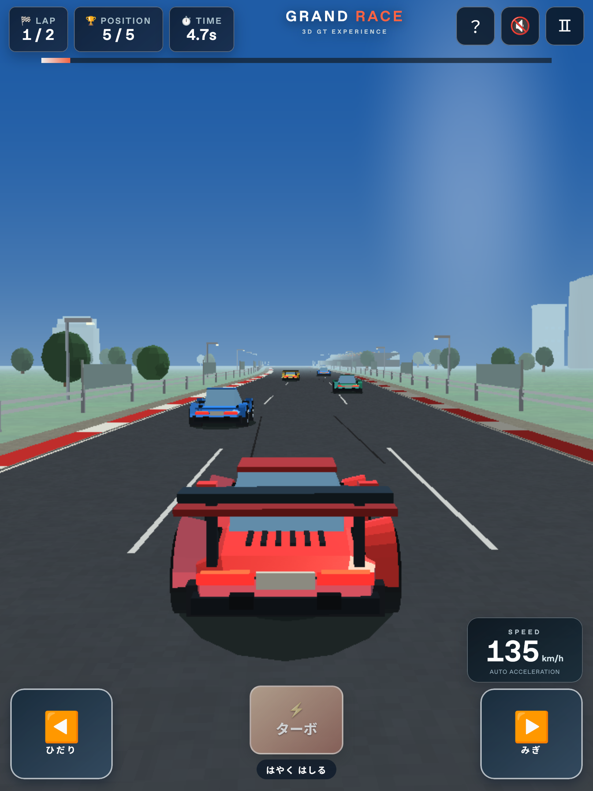

# Ver.4 調査・検証報告

## 確認できた初期化失敗の原因

調査対象：`test553378/my-drive` の変更前HEAD **`c1fbde3`**。

`index.html` の頂点シェーダーとフラグメントシェーダーは、同名の共有uniform `uEye` を `uniform vec3 uEye;` と宣言していました。頂点側のデフォルト精度は `highp`、フラグメント側は先頭の `precision mediump float;` により `mediump` です。共有uniformの精度が一致しないため、プログラムのリンクが失敗します。

変更前のコードをそのままHTTP配信し、次を確認しました。

| 実行環境                           | コンテキスト生成 | ワールドシェーダーのリンク | 実際のエラー                                                               |
| ---------------------------------- | ---------------- | -------------------------- | -------------------------------------------------------------------------- |
| Chromium 141 / Linux / SwiftShader | 成功             | 失敗                       | `Precisions of uniform 'uEye' differ between VERTEX and FRAGMENT shaders.` |
| Playwright WebKit 26.0 / Linux     | 成功             | 失敗                       | `Precisions of uniform 'uEye' differ between VERTEX and FRAGMENT shaders.` |

比較のため、変更前コードの `uEye` 宣言を両側とも `uniform mediump vec3 uEye;` に揃えた版では、Chromiumで初期化と描画が成功し、WebGLエラーは0でした。さらに自動テストで元の精度不整合を最小シェーダーとして再現し、両側で精度を一致させるとリンクできることを検証します。

**旧画面の「3Dをひょうじできませんでした」は、コンテキスト生成失敗にもシェーダー失敗にも同じ表示を使っていました。** この表示だけで「iPadがWebGL非対応」「GPUメモリ不足」とは判断できません。今回確認できた根本原因は上記のシェーダーリンク不整合です。ご利用のiPadで別の障害も起きているかは実機ログがないため未確定です。

## 修正と改善

最終実装では、頂点側で `p - uEye` を計算してフラグメント側へ渡し、フラグメント側の `uEye` を削除しました。共有uniformの不整合をなくし、フラグメント内で大きなワールド座標同士を引く計算も避けています。varyingの精度は両側で `mediump` と明示し、フラグメントの `highp` は必須にしていません。ノイズ計算の中間値も `mediump` の範囲内に抑えています。

初期化の各段階と実際のシェーダーログを端末内に記録する診断画面を追加しました。コンテキスト取得失敗、コンパイル失敗、リンク失敗、描画エラー、喪失・復帰、ファイル読込失敗を区別できます。自動送信・保存はしません。

画面の縦横両方を考慮したピクセル予算、MSAAの無効化、見えるコース区間だけの描画、遅い状態での自動画質調整を追加しました。これは描画負荷を下げるための改善です。**GPU負荷を今回の初期化エラーの原因と断定して行った修正ではありません。**

WebGLの喪失時にはレースと描画を止め、復帰時には全GPUリソースを再構築します。タブ離脱、画面非表示、入力キャンセル時には操作を解除し、バックグラウンドからの復帰時にレースが飛ばないようにしました。遅い可視フレームは小さな物理ステップに分けて処理します。

車両はオリジナル2形状・4色。曲面を持つボンネット、タイヤの開口があるフェンダー、スポーツクーペとスーパー系のルーフ／ウイング、ガラス反射、ライトを描画します。回転量は走行距離から積算し、加減速でタイヤの回転位相が飛ぶ問題を解消。前輪の操舵、加速時のピッチ、旋回時のロール、一定距離の追従カメラを組み合わせました。

4〜5歳向けに自動コース追従、中央復帰、コース端のガード、軽い接触減速を追加しました。ターボやステアリングを使わなくても完走できます。実際の対象年齢の子どもによる操作性評価は未実施です。

## 自動検証結果

ローカル実行：Node.js 24.22.1、Playwright 1.56.1、Chromium 141、WebKit 26.0、Linux。ChromiumはSwiftShaderを使用しました。ブラウザにiPadの画面・タッチ設定を適用しても、OSとGPUはiPadにはなりません。

| 検証                   | 結果              | 内容                                                                                                                                                                                                                                                                                                                                |
| ---------------------- | ----------------- | ----------------------------------------------------------------------------------------------------------------------------------------------------------------------------------------------------------------------------------------------------------------------------------------------------------------------------------- |
| 構文・整形チェック     | 成功              | `npm run check`、`git diff --check`                                                                                                                                                                                                                                                                                                 |
| 純粋な走行ロジック     | 10件成功          | 操作／ターボなしの2周完走、左右を押し続ける場合のコース端保護、中央復帰、ターボ・回復、一時停止、接触、距離に連動するタイヤ回転、30/60fps比較、極端な経過時間、周回境界                                                                                                                                                             |
| Chromiumのブラウザ検証 | 15件成功          | 実シェーダーのリンクと描画、元の精度不整合の再現、2車両×4色、操作・キャンセル、カウントダウン中の停止、縦横画面、診断・JSON保存・キーボードフォーカス、コンテキスト取得拒否、コンパイル／リンク失敗の注入、GPUコンテキスト喪失と復帰、全ファイルのキャッシュ、実際のオフライン再読み込み、非表示／復帰、2周の描画・ゴール・再レース |
| WebKitのブラウザ検証   | 14件成功・1件除外 | 上記のうちオフライン再読み込みを除く。2周完走・再レースと、`WEBGL_lose_context` によるリソース再構築も成功                                                                                                                                                                                                                          |

ローカルでは段階的に実行しました。最終テスト定義は合計30ケース（Chromium 15＋WebKit 15）で、29ケースを確認し、以下の1ケースを理由付きで除外しています。単体テスト10件は別集計です。公開中のGitHub PagesやiPad実機をテストした結果ではありません。

### WebKitのオフライン検証に関する制約

最初の全体実行では、Chromium 12件・WebKit 11件が成功し、**WebKitの `context.setOffline(true)` 後のナビゲーション1件が `WebKit encountered an internal error` で失敗**しました。ゲームのコードを含まない、HTMLと最小Service Workerだけのキャッシュページでも同じエラーが再現しました。ネットワークをWeb Inspectorで遮断する方法でもナビゲーションが遮断されました。

この結果からゲーム側の推測修正はしていません。Linux版Playwright WebKitの該当オフラインテストを明示的に除外し、必要ファイル7個がすべて正常な内容でキャッシュされることを両ブラウザで別途検証しています。Chromiumの真のオフライン再読み込みは成功しています。**Safari実機でのオフライン起動は未検証**であり、WebKitについて成功したとは報告しません。

最小再現用スクリプトを残しています（ゲームは起動しません）。

```sh
node tests/repro-webkit-offline.js
```

CIでは `npm run test:e2e` で全ケースを実行します。LinuxのWebKitオフラインテストは同じ制約を理由付きで除外し、レポートにも表示します。

## iPad実機で必要な確認（未検証）

以下はLinux上のWebKitやiPadプロファイルでは確定できません。

- 対象iPadの機種・iPadOSごとに、Safariで初回起動と再読み込みを実行。診断の `version: 4.0.0`、初回描画成功、エラー有無を確認する。
- 実際のSafari／Metalドライバーでのシェーダー互換性、車体の反射・路面の描画欠け、縁の品質、安定したフレームレート。診断の `frameMs` は可視フレーム間隔の平滑値で、GPU処理時間ではない。
- 10〜15分の連続走行と複数レース。発熱、バッテリー、低電力モード、メモリ圧迫、別タブ併用時の安定性。60fpsの保証はしていない。
- 縦横回転、Safariのツールバー伸縮、セーフエリア、ホーム画面追加起動。メニューや診断のタッチスクロール、ボタンの見切れ。
- 2本指で「左右＋ターボ」、同時に左右、押したまま離脱、指をスライドして離す操作。意図しないスクロールや押しっぱなしが残らないこと。
- タブ切替、画面ロック、30秒以上のバックグラウンド、履歴からの復帰。停止した位置から、利用者のタップで安全に再開すること。
- 実際のGPU喪失・OSによるプロセス終了。自動テストの `WEBGL_lose_context` はイベントとリソース再構築を検証するもので、OSの強制終了やSafariのページ再起動を再現しない。復帰イベントが来なければ再読み込みが必要。
- 音声のオン・オフ、ロック後の音声再開、他アプリの音声割り込み。初期ミュートとユーザー操作による解除。
- 旧Ver.3を使っていたSafari／ホーム画面アプリでの更新。古いService Workerからの実際の移行、オフラインキャッシュがSafariの保持対象であるか。
- オンラインで一度起動した後、機内モードでSafari／ホーム画面から起動。Safariによるデータ削除・キャッシュ退避後にはオンライン接続が必要。
- 診断レポートのコピー・JSON保存、エラー画面の読みやすさ。機種とiPadOSは報告時に手動で記入する。
- 4〜5歳の子どもが、大人の見守りのもとで操作しやすいか、2周の長さが適切か、左右ボタンと中央復帰が分かりやすいか。

## 公開と再現方法

本体は静的ファイルだけです。既存のGitHub Pages設定（`main` / root）を使えます。変更をマージした後、Pagesビルドの成功と公開URLでの診断バージョンを確認してください。PRブランチは公開中のPagesと別のため、ローカルテストが成功しても公開ページに反映済みとは限りません。

```sh
npm ci
npm run check
npm test
npx playwright install --with-deps chromium webkit
npm run test:e2e
```

GitHub Actionsにも上記の検証を追加しました。ブラウザテストは `/my-drive/` のサブパスで実行し、テスト依存は実行用ファイルから参照しません。

## 描画確認

Linux上のPlaywright WebKitで撮影した走行画面です。iPad実機での画質・性能を示すものではありません。


